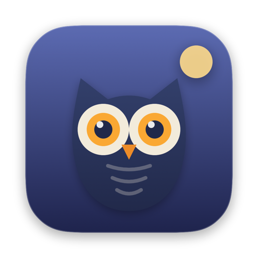
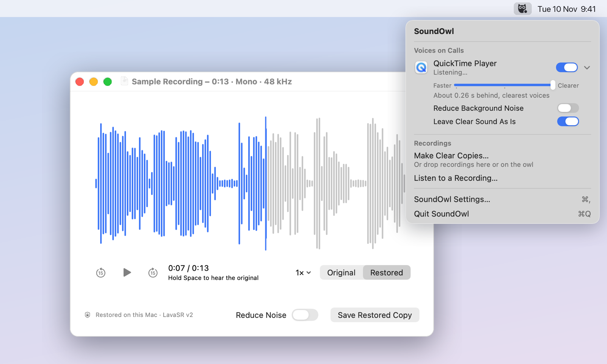

<p align="center">
  
</p>

<h1 align="center">SoundOwl</h1>

<p align="center">
  <em>Make voice recordings clear again. On your Mac, in seconds.</em>
  <br>
  <a href="https://fanckush.github.io/SoundOwl/">fanckush.github.io/SoundOwl</a>
</p>

<p align="center">
  <a href="https://github.com/fanckush/SoundOwl/actions/workflows/ci.yml"></a>
  <a href="https://github.com/fanckush/SoundOwl/actions/workflows/ci.yml"></a>
  <a href="https://github.com/fanckush/SoundOwl/releases/latest"></a>
  <a href="https://github.com/fanckush/SoundOwl/releases"></a>
  <a href="LICENSE"></a>
  
  <a href="#install"></a>
</p>

<p align="center">
  
</p>

Phone calls, old podcasts, voice memos, lectures, audiobooks ripped at low quality: they all sound
muffled, because the top half of the voice was thrown away somewhere along the line. SoundOwl
rebuilds it.

SoundOwl lives in your menu bar. It's made for speech, not music.

- **Calls.** Click the owl and switch on the app you call with (Zoom, Teams, a browser…). The
  other people are restored as you hear them, about a fifth of a second behind, every time that
  app plays, for as long as SoundOwl runs. Music and sound that's already clear play untouched.
  Headphones only by default. The arrow next to an app's switch trades delay for clarity and
  turns on noise reduction.
- **Clear copies.** Drop recordings on the owl, or right-click them in Finder › **Restore with
  SoundOwl**. Copies appear next to the originals as `Name (Restored).m4a`, progress under the owl.
  The **Restore Audio** Shortcut and `soundowl restore *.m4a` in Terminal do the same.
- **Listening.** Open a recording, podcast or audiobook with SoundOwl and it plays restored right
  away, even if it's ten hours long. Hold <kbd>Space</kbd> to hear the original. Speed, ±15 s
  skips, chapters, media keys, and it remembers where you stopped. Close the window and it's gone;
  **Save Restored Copy** (<kbd>⌘S</kbd>) if you want a file.

- **Runs entirely on your Mac.** No account, no upload, no subscription. Works offline.
- **Fast.** An hour of audio restores in well under a minute on an M-series Mac.
- **Leaves your originals alone.** Copies go next to them as `Name (Restored).m4a`, with the title,
  artist, album, track number and artwork carried over.
- **Out of the way.** Just an owl in the menu bar; a Dock icon only while you're listening. Started
  by Finder or a Shortcut for a job, it leaves again when the job is done.
- **Free and open source.**

🎧 **Hear before and after on [the website](https://fanckush.github.io/SoundOwl/).**

## Install

<p align="center">
  <a href="https://github.com/fanckush/SoundOwl/releases/latest/download/SoundOwl.dmg">
    <picture>
      <source media="(prefers-color-scheme: dark)" srcset="docs/assets/download-mac-dark.svg">
      
    </picture>
  </a>
</p>

or

```sh
brew install --cask fanckush/soundowl/soundowl
```

On first launch SoundOwl downloads its voice model (52 MB, once). Updates arrive by themselves,
or through **Settings › General › Check Now**.

Requires macOS 15 or later on Apple Silicon. On macOS 26 it uses Liquid Glass.

The Homebrew cask also puts `soundowl` on your `PATH`. With the DMG, link it once:

```sh
ln -sf /Applications/SoundOwl.app/Contents/Resources/soundowl /usr/local/bin/soundowl
soundowl --help
```

`soundowl restore` takes files and folders, `--denoise`/`--no-denoise`, `--format` and
`--output-dir`. It prints the restored paths on stdout, so it composes with other tools, and exits
non-zero if any file failed. `soundowl model status|download|remove` manages the voice model.

## How it works

SoundOwl runs [**LavaSR v2**](https://github.com/ysharma3501/LavaSR) by Yatharth Sharma, a
50 MB speech restoration model ([paper](https://arxiv.org/abs/2603.07285)). It's a bandwidth
extension model: it takes speech whose high frequencies were lost to a phone line, a cheap
microphone or heavy compression, and predicts them back, up to 48 kHz. The optional
**Reduce background noise** switch adds the [UL-UNAS](https://github.com/Xiaobin-Rong/ul-unas)
denoiser by Xiaobin Rong et al.

The models run through [ONNX Runtime](https://onnxruntime.ai) on the CPU. Everything around them
(the STFTs, resampling, and merging the predicted highs with your original lows) is native Swift
on Apple's Accelerate framework. That native pipeline is tested to reproduce the reference PyTorch
implementation: 105–117 dB SNR on the reference clips, and 64 dB on the 8 kHz phone clip. [docs/engine.md](docs/engine.md)
has the details.

Some numbers from an M5 Pro:

| | Speed |
| --- | --- |
| Restore | ~140× realtime (an hour of mono audio in under 30 s) |
| Restore with noise reduction | ~48× realtime |
| Memory while restoring | ~600 MB, released when idle |

Long recordings are restored in 30-second chunks, starting from wherever you're listening, so
playback can start immediately. While listening, SoundOwl stays about ten minutes ahead of you
and lets go of what's far behind, so an audiobook doesn't fill your disk. The chunks are lined up on the model's frame grid, so the seams
are mathematically invisible: no crossfades, no clicks.

The model is not bundled with the app. It's downloaded from this repository's releases, checked
against a SHA-256 pinned in the app, and stored in `~/Library/Application Support/SoundOwl`.
Settings › Model shows what's installed and lets you remove it.

## Build from source

Requires Xcode 26 on an Apple Silicon Mac.

```sh
scripts/fetch-model.sh                # the model package, for tests and the CLI
swift test                            # engine parity, chunking, export, model install, CLI
swift run -c release soundowl restore in.m4a        # the shipped CLI
swift run -c release soundowl-dev restore in.m4a out.wav [--denoise]
swift run -c release soundowl-dev bench in.m4a

open SoundOwl.xcodeproj               # scheme "SoundOwl", then Run
```

[CONTRIBUTING.md](CONTRIBUTING.md) covers the layout, the model export tooling and how releases
are made.

## Support

SoundOwl is free. If it's useful to you, you can support it on
[GitHub Sponsors](https://github.com/sponsors/fanckush).

## Credits

- [LavaSR](https://github.com/ysharma3501/LavaSR) by Yatharth Sharma (Apache-2.0), the model that
  does the actual work.
- [UL-UNAS](https://github.com/Xiaobin-Rong/ul-unas) by Xiaobin Rong et al. (MIT), the denoiser.
- [Vocos](https://github.com/gemelo-ai/vocos), the vocoder architecture LavaSR builds on.
- [ONNX Runtime](https://github.com/microsoft/onnxruntime) and
  [Sparkle](https://sparkle-project.org).
- [DiffusionBee](https://diffusionbee.com), for showing how friendly a local AI app can be.
- Sample audio: *Alice's Adventures in Wonderland*, read for [LibriVox](https://librivox.org)
  (public domain).

See [THIRD_PARTY_NOTICES.md](THIRD_PARTY_NOTICES.md).

## License

[Apache-2.0](LICENSE), the same license as the LavaSR model.
